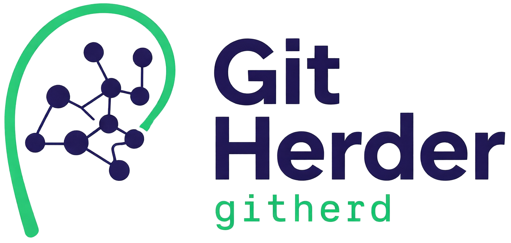

# Git Herder

Git Herder (`githerd`) is a command-line tool for bulk operations on git
repositories. It works with repositories on GitHub and GitLab, and with
local working copies of those repositories.

It takes the routine out of large repository sets in microservice and
modular systems: select many repositories once, then clone, sync, switch,
merge, publish, or run `git pull`, `git push`, `git fetch`, and
`git remote` across them.

## Install

You need Go and `git` on `PATH`. Git Herder runs the `git` already
installed on the machine.

```bash
go install github.com/git-herder/git-herder/cmd/githerd@latest
githerd --version
```

## Use

```bash
githerd --help
githerd clone --help
githerd sync
githerd pull --rebase origin main
```

Global flags, commands, and exit codes are specified in
[documentation-specifications](https://github.com/git-herder/documentation-specifications).

Credentials are passed through environment variables or the operating
system. Git Herder does not store them.

## Repositories

| Repository | What it holds |
| --- | --- |
| [git-herder](https://github.com/git-herder/git-herder) | The `githerd` CLI-application source code |
| [documentation-product-intent](https://github.com/git-herder/documentation-product-intent) | Why the product exists |
| [documentation-architecture](https://github.com/git-herder/documentation-architecture) | Application structure (ArchiMate) |
| [ADR](https://github.com/git-herder/ADR) | Architecture decisions |
| [documentation-specifications](https://github.com/git-herder/documentation-specifications) | CLI and platform contracts |
| [glossary](https://github.com/git-herder/glossary) | Shared terms |
| [playbook](https://github.com/git-herder/playbook) | Team principles and workflow |

## License

[MIT](https://github.com/git-herder/git-herder/blob/master/LICENSE.txt)
